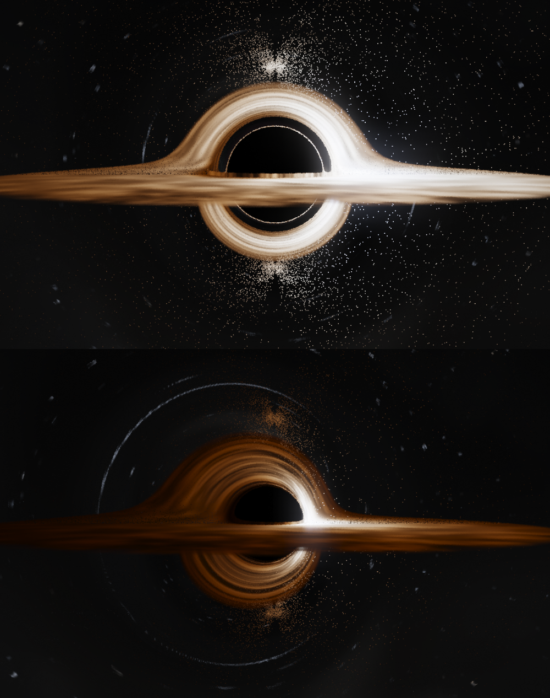
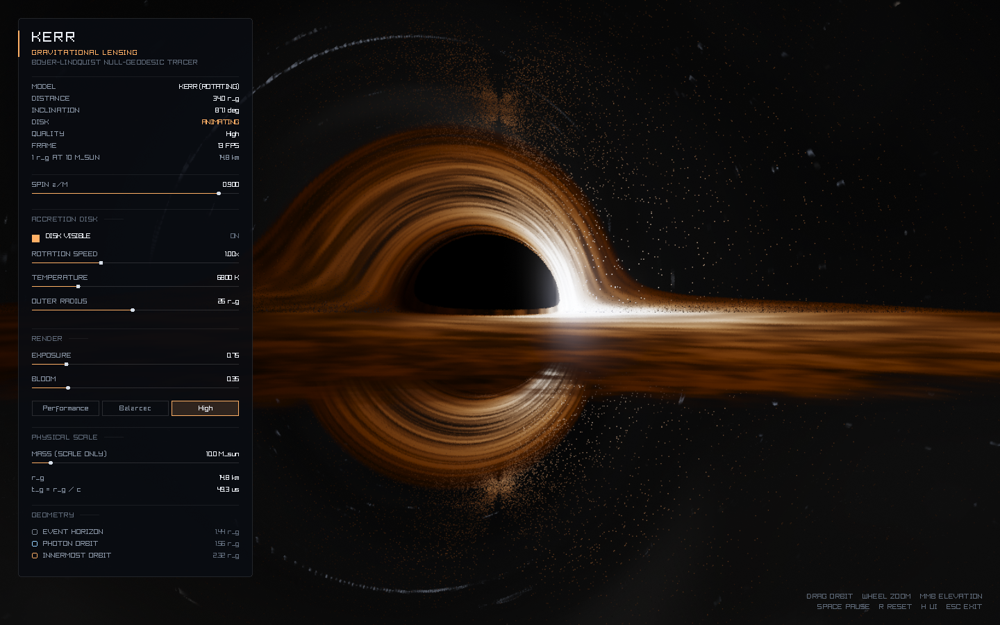

# Kerr Black Hole — Real-Time Gravitational Lensing

An interactive, real-time black-hole renderer in C++20 + raylib. Every pixel is a
backward-traced null geodesic of the **Kerr** metric, integrated on the GPU with
fourth-order Runge–Kutta in affine parameter (Boyer–Lindquist coordinates,
Carter-separated first-order equations). The shadow, the photon ring, the
multiple images of the far side of the disk, the warped star field, and the
lopsided shadow of a spinning hole all emerge from those trajectories — there is
no UV warp, fisheye, or lensing-strength slider anywhere in the pipeline.

`a = 0` is Schwarzschild (round shadow, ISCO at `6 r_g`); `a → 1` is
near-extremal (D-shaped shadow, ISCO at `1.24 r_g`).


Spin `a = 0` (top) versus `a = 0.9` (bottom), same camera: the shadow contracts,
shifts, and the approaching side of the disk brightens.



## Build

Requirements: CMake ≥ 3.24, a C++20 compiler, OpenGL 3.3. raylib **6.2** is
fetched automatically with `FetchContent` (or reused if a matching installed
copy is found), so the first configure needs network access; the application
itself never does.

Windows (MinGW-w64 UCRT64):

```bash
export PATH=/c/msys64/ucrt64/bin:$PATH
cmake -S . -B build -G Ninja -DCMAKE_BUILD_TYPE=Release
cmake --build build
./build/blackhole.exe
```

Linux / macOS (generic):

```bash
cmake -S . -B build -DCMAKE_BUILD_TYPE=Release
cmake --build build
./build/blackhole
```

Headless / reproducible captures (renders a few frames, saves a PNG, exits):

```bash
./build/blackhole --capture shot.png --size 1600x900 --quality high \
                  --distance 34 --pitch 0.05 --yaw 2.2 --spin 0.9 --no-ui
```

Shaders are copied next to the executable after each build, and the loader also
falls back to the source tree, so the binary runs from the build directory, from
an install tree, or from any other working directory.

Tests (no GPU or window needed):

```bash
ctest --test-dir build --output-on-failure
```

Frame-time benchmark (vsync off, prints median / p95 / best, no window shown):

```bash
./build/blackhole --bench 120 --size 1920x1080 --quality balanced
```

## Physics

Distances are in gravitational radii, `r_g = GM/c²` (`G = c = 1`, `M = 1`), the
spin is the dimensionless `a = J/M²`, and the disk axis is world `+Y`. All
geometry is spin dependent:

| Feature | Radius |
|---|---|
| Event horizon | `r₊ = 1 + √(1 − a²)` |
| Prograde photon orbit | `2[1 + cos(⅔ arccos(−a))]` |
| Prograde ISCO | `3 + z₂ − √[(3 − z₁)(3 + z₁ + 2z₂)]` (Bardeen–Press–Teukolsky) |
| Disk inner edge | the prograde ISCO (moves with spin) |
| Shadow edge, `a = 0` | `3√3 r_g ≈ 5.196 r_g` |

For `a = 0` those reduce to `2 r_g`, `3 r_g` and `6 r_g`.

**Ray tracing.** With spin the geodesics are no longer planar, so the tracer
uses the Carter-separated first-order system rather than a single Binet
equation. Each ray is described by its exact constants

```
E = −p_t,   L = p_φ,   Q = p_θ² + cos²θ (L²/sin²θ − a²E²)
```

and the motion obeys

```
Σ dr/dλ   = ±√R(r),          R(r) = [E(r²+a²) − aL]² − Δ[(L − aE)² + Q]
Σ dθ/dλ   = ±√Θ(θ),          Θ(θ) = Q + a²E²cos²θ − L²cos²θ/sin²θ
Σ dφ/dλ   = [2arE + L(Σ − 2r)/sin²θ] / Δ
Σ = r² + a²cos²θ,   Δ = r² − 2r + a²
```

The polar state is the unit pair `(cos θ, sin θ)`, advanced by the exact
identities `d(cos θ, sin θ)/dλ = dθ/dλ · (−sin θ, cos θ)` and renormalised once
per step. That keeps the inner loop free of transcendentals while retaining full
relative precision in `sin²θ` near the pole, where the `L/sin²θ` term in
`dφ/dλ` spikes and carries the entire ~π sweep of a near-axis ray. (A
`u = cos θ` state cannot resolve that region in float32: `sin²θ` falls below the
ulp of `u` near 1, and the sweep integrates as per-pixel noise — the classic
"torn seam" of spinning-black-hole renderers along the projected spin axis.)
Because `E`, `L` and `Q` are integrals of the motion, the trajectory cannot
drift off the null cone.

Initial conditions come from the static observer's orthonormal frame at the
camera. With local direction cosines `n`,

```
k = e_t + n_r e_r + n_θ e_θ + n_φ e_φ
e_t = ∂_t/√(−g_tt),  e_r = √(Δ/Σ) ∂_r,  e_θ = ∂_θ/√Σ,
e_φ = β (∂_φ − (g_tφ/g_tt) ∂_t),   β⁻² = g_φφ − g_tφ²/g_tt
```

which is exactly the Schwarzschild construction at `a = 0` (where the impact
parameter is `b = r₀ sin ψ / √(1 − 2/r₀)`, `du/dφ = −cos ψ / b`).

**Integration.** Classical RK4 on `(r, θ, φ)` with the sign of each square root
held as state and flipped at turning points. The step is the strictest of three
rulers:

* **geometric**, `dλ = h·r` — strides through the nearly straight far field and
  stays finite at a turning point. Beyond `60 r_g`, a ray moving outward whose
  radial potential is still positive at `2r` (no turning point ahead) gets its
  cap grown to `6h·r` — the far ruler. The rulers below keep their authority, so
  the growth only ever lengthens a step the bending already allowed;
* **angular**, `dλ = 0.6h / max(|dφ/dλ|, |dθ/dλ|)` — the bending near the hole is
  what the image is made of; a purely geometric ruler under-resolves it by ~4×
  at `h = 0.035`;
* **pole-proximity**, `dλ = 0.25·sin θ / |dθ/dλ|` (only where the centrifugal
  barrier exists, i.e. `L ≠ 0`) — keeps the θ travel a fraction of the distance
  to the pole so the `L/sin²θ` spike in `dφ/dλ` cannot change by orders of
  magnitude inside one step. A step that leaps into the spike samples it in one
  RK4 stage only and integrates it as garbage: that single step, not the
  gradual approach, is what scrambles near-axis pixels. Inside the spike the
  angular ruler takes over and resolves it. `L = 0` rays skip this ruler: they
  legitimately cross the axis and would otherwise stall at it.

Turning-point overshoots are mirrored about the *turning point itself* — the
double-angle reflection `θ → 2θ_T − θ` (or `2(π − θ_T) − θ` at the south pole)
on the `(cos θ, sin θ)` pair, with `sin²θ_T` the small positive root of
`Θ = 0` in a cancellation-free form — and not about the step start: mirroring
about the start can land on the wrong side of the equatorial plane and silently
drop disk hits. A ray with exactly `L = 0` never enters the mirror branch: its
geodesic passes through the axis, which is its correct continuation.

Termination (the far ruler and the capture cut are mirrored in the CPU tracer
`include/kerr.hpp` and pinned by `tests/physics_tests.cpp` against untricked
reference traces):

* `r ≤ r_ph^pro` and moving inward → captured. The prograde photon orbit is the
  smallest radius any photon can turn at, so the ray's perigee is provably below
  every turning point — it is captured *here*, not eventually. Without the cut a
  plunging ray creeps through the `dφ/dλ` spike as `Δ → 0` until its budget runs
  out; a black shadow pixel used to cost its full 1200 steps.
* `r ≤ r₊` or `Δ < 0` → captured, the pixel stays on the shadow;
* disk transmittance below 0.002 → the march ends early: an opaque disk leaves
  no later image and no piece of sky able to contribute through it;
* `r ≥ 900 r_g` and `dr/dλ > 0` → escaped, the background is sampled along the
  reconstructed 3D direction `r̂·dr + θ̂·r·dθ/dλ + φ̂·r sin θ·dφ/dλ`;
* a step budget that runs out means a near-critical orbit still winding around
  the photon sphere; it is treated as captured. That is what bounds the shader's
  runtime — there is no unbounded data-dependent loop. (Treating it as an escape
  instead lets such rays sample the sky in a direction they never reached, which
  speckles the shadow edge with stars.)

**Accretion disk.** A geometrically thin equatorial slab (`h/r ≈ 0.012`) between
the ISCO and an adjustable outer radius (26 r_g by default). Crossings are found
between consecutive steps and refined with a cubic Hermite root of `cos θ`; the
plain linear root is off by `O(dλ²)`, which at `dλ ≈ 3 r_g` walks the hit radius
by a visible fraction of `r_g` from pixel to pixel. Optical depth is
`τ = ρ · 2h/|cos i|`, so grazing rays accumulate a long column and the disk goes
opaque edge-on while face-on views stay translucent. Emission uses a
Shakura–Sunyaev effective temperature

```
T(r) ∝ [ (1 − √(r_in/r)) / r³ ]^¼
```

with `σT⁴` bolometric falloff, and turbulent density/temperature modulation from
a seamless procedural noise field advected at the local Keplerian rate
`Ω = 1/(r^{3/2} + a)`, so the pattern shears into trailing filaments on its own.

**Relativistic shifts.** Each sample is shifted by the full Kerr circular-orbit
factor

```
g = 1 / [ u^t (1 − Ω L/E) ],   Ω = 1/(r^{3/2} + a)
u^t = (r^{3/2} + a) / [ r^{3/4} √(r^{3/2} − 3r^{1/2} + 2a) ]
```

The square root carries the gravitational and transverse Doppler redshift of the
orbit; the denominator carries the line-of-sight Doppler boost. `L/E` is the
traced photon's conserved ratio, **negated** because the tracer runs backwards in
time: the physical photon's energy measured by the orbiting emitter is
`u^t(E − ΩL) > 0`, so the reverse ray needs `−L`. `g` drives both the blackbody
colour (`T_obs = gT(r)`) and the beaming `I ∝ g⁴`, which is why the approaching
side is blue-white and blown out while the receding side is dim orange.

**Sky.** Two layers, split by what survives being magnified:

* **Baked deep field** — a 512-per-face cubemap with a full mip chain, holding
  only *smooth* unresolved light: the galactic band (warm bulge, filaments of
  dust with exponential extinction), a star haze carrying the mean light of the
  faint population, and two emission nebulae. No discrete stars are baked: a
  texel-scale blob magnifies into a visible block exactly where the lens map
  stretches the sky — that is the grey "confetti" the old render showed along
  the caustics. The bake stores √radiance (the band is faint enough that 8-bit
  linear quantises it into patches) and is sampled with an explicit footprint
  LOD — the pixel's angular size widened by the local lens compression — so a
  folded pixel reads a blurrier mip instead of aliasing.
* **Analytic stars** — resolved stars drawn in the shader from a 3D hash
  lattice (0.018 rad cells, 4 % occupied), blackbody-tinted with a steep
  magnitude distribution. The profile width follows the pixel footprint but is
  capped at `CELL/6`, the largest σ the eight-cell lattice search can cover
  without clipping profiles into squares. Where the footprint outgrows the cap
  — a pixel covering a whole folded strip of sky — the layer cross-fades into
  the strip's mean radiance (which the deep field's star haze already carries),
  so folded sky reads as smooth lensed glow instead of clipped blobs.

Because both layers are sampled along the *deflected* direction, the sky is
displaced, magnified into arcs and multiply imaged for free.

## Rendering

```
scene (HDR RGBA16F, scaled internal resolution)
  → bright-pass + two-scale Gaussian bloom (1/4 and 1/8 res, separable)
  → ACES tone map, exposure, bloom mix, vignette, gamma, 1/255 dither
  → upscaled to the window
```

All per-pixel physics is in `shaders/blackhole.fs`; the C++ side only manages
windows, input, uniforms and passes. The shader refuses to run if any uniform it
needs is missing, and reports the GLSL compiler log with line numbers on failure.

| Preset | Internal resolution | Step `h` | Max steps | Rays/pixel |
|---|---|---|---|---|
| Performance | 62 % | 0.055 | 420 | 1 |
| Balanced | 82 % | 0.035 | 1200 | 1 |
| High | 88 % | 0.022 | 1400 | 2 (jittered) |

Measured on this branch's development machine (1280 × 720 window, spin 0.9,
camera at 46 `r_g`, near edge-on — the heaviest common view; medians and p95 of
an 80-frame `--bench 80` run per preset), before and after the sky rework:

| Preset | Internal | Median (old sky) | Median (reworked) | p95 (reworked) |
|---|---|---|---|---|
| Performance | 794 × 446 | 9.4 ms | 5.5 ms | 7.6 ms |
| Balanced | 1050 × 590 | 38.2 ms | 23.4 ms | 25.0 ms |
| High | 1126 × 634 | 76.6 ms | 53.3 ms | 58.2 ms |

The rework is **1.4–1.7× faster at every preset** and the sky looks better: the
march tricks below cut steps (the far field strides 6×, a plunging ray stops at
the photon orbit instead of burning its budget, an opaque disk ends the march),
and the sky is one cubemap fetch with footprint LOD plus an eight-cell lattice
search instead of an over-wide star profile.

(An earlier table on different hardware measured the old sky at 3.3 / 15.6 /
49 ms; absolute numbers are machine-dependent, the ratios above are not.)

### Where the time goes, and what is worth optimizing

Measured, not assumed:

* **The geodesic integrator is ~95 % of the frame.** With the step budget cut to
  20 (scene pass nearly free) the whole frame still takes 0.64 ms against 12.9 ms
  at full budget, so bloom, composite, the UI and the presentation are noise.
  Optimizing anything except the ray march is pointless.
* **The derivative evaluation is the hot path**, four times per RK4 step. Two
  changes paid for themselves and are in: RK4's first stage is reused as the step
  ruler (it is the same point and the same derivative — this removed one of five
  derivative evaluations per step), and the ray constants of `R(r)` and `Θ(u)`
  are hoisted out of the loop. Measured: 12.2 ms → 11.0 ms (Balanced, 1050 × 590).
* **Accuracy costs more than it looks.** The Newton refinement of the radial
  turning radius is worth ~10× in bending accuracy (0.019 rad → 0.002 rad), but
  writing it as a `for` loop inside the hot loop cost 20 % of the frame; written
  as one straight-line step it costs nothing. Loops in the inner loop of a
  fragment shader are not free even when they run once.
* **Step count is the quality dial, and it is honest.** Relaxing the angular
  constant from 0.6 to 1.0 buys 18 % (11.1 → 9.1 ms) but changes 11 % of pixels
  by more than 8/255, i.e. it costs real accuracy in the disk band. Raising the
  step budget instead costs time: the same view at 320 rather than 1200 steps
  runs at 7.5 ms but truncates 0.3 % of pixels, mostly on the photon ring.
* **What is *not* worth it here:** more derivative terms, SIMD-style packing of
  the AA samples, or a separate low-res sky pass. The first two are micro-tuning
  of an already tiny per-step cost; the third saves at most the 0.85 ms measured
  above.

If you need more speed, the lever with real headroom is the step *count*: a
higher-order integrator, or an early-out for rays whose impact parameter is far
outside the shadow (they cannot reach the disk and barely bend). Neither is
implemented.

## Controls

| Input | Action |
|---|---|
| Left drag | Orbit the camera |
| Mouse wheel | Zoom |
| Middle drag (or Ctrl + right drag) | Change elevation |
| Arrow keys, `+` / `-` | Orbit / zoom from the keyboard |
| `Space` | Pause or resume disk animation |
| `R` | Reset the camera and view |
| `H` | Show or hide the interface |
| `1` / `2` / `3` | Performance / Balanced / High quality |
| `Esc` | Quit |

The camera is clamped to `[8, 90] r_g` and to `±83°` elevation, so it can never
enter the horizon, and the orbit basis stays well conditioned away from the
poles. The disk inner radius follows the spin-derived ISCO, so the disk cannot
reach inside its own last stable orbit.

The panel shows the model, camera distance in `r_g`, inclination, animation
state, quality, frame rate, the physical scale of one `r_g` (mass changes units
only, never the image), and the spin-dependent horizon / photon orbit / ISCO
radii. Its controls all write the live simulation state used by the renderer:

* **spin `a/M`** (0 … 0.998) — reshapes the shadow and moves the ISCO;
* disk visibility, rotation speed, temperature, outer radius;
* exposure, bloom, quality preset;
* mass (scale readout only), interface visibility.



## Layout

```
CMakeLists.txt
include/  kerr.hpp                 CPU Kerr geodesic integrator + spin geometry
          geodesic.hpp             CPU Schwarzschild reference integrator, disk kinematics
          simulation_parameters.hpp  parameters, quality presets, scale helpers
          textures.hpp             procedural sky + noise generation
          camera_controller.hpp    orbit camera with damping and clamps
          renderer.hpp             HDR targets, bloom, composite passes
          ui.hpp                   immediate-mode panel
          application.hpp          window, loop, input
src/      main.cpp                 CLI parsing
          application.cpp camera_controller.cpp renderer.cpp
          simulation_parameters.cpp textures.cpp ui.cpp
shaders/  blackhole.fs             Kerr ray march, disk shading, sky
          blur.fs                  separable Gaussian
          composite.fs             bloom mix, ACES, gamma
tests/    physics_tests.cpp        71 assertions, no GPU required
```

The test suite covers the CPU mirror of the shader's math: spin geometry against
the textbook formulas (`a = 0`, `0.5`, `0.998`), the Schwarzschild shadow edge,
prograde/retrograde capture asymmetry at `a = 0.9`, bending angle against the
Schwarzschild tracer, mirror symmetry about the disk plane at `a = 0`, and
crossing-radius continuity across the grazing columns that used to produce dark
filaments.

## Approximations and known limits

* **No ergosphere or penrose effects** beyond what the metric implies: the disk
  is prograde only, and there is no jet, no magnetosphere, no radiative transfer.
* **Thin, opaque-when-grazing disk.** The vertical structure is a slab of constant
  `h/r` with no scattering, self-illumination or limb darkening. Multiple
  crossings are composited front to back.
* **Thin-slab artifact at grazing angles.** With no rim wall, a sightline that
  grazes the equatorial plane *inside* the ISCO passes through the disk's hole
  and then falls in, so a narrow dark filament appears at the one azimuth where
  the view is tangential (most visible near edge-on, at high spin). A volumetric
  or rim-modelled disk would fill it.
* **The Doppler factor is bounded** to `g ∈ [0.08, 5]` for display. On paper `g`
  diverges for a ray emitted exactly along the orbital motion; a thin,
  non-limb-darkened disk cannot resolve that, so `g⁴` is clipped instead of
  saturating the frame.
* **Step budget = capture.** A ray that exhausts its budget is treated as
  captured. This is exact to within the shadow edge (those rays are within a
  fraction of a pixel of the critical curve), but it does mean the outermost
  higher-order images are truncated at the budget rather than resolved.
* **Folded sky is smooth.** Where one pixel covers a whole folded strip of sky
  (right at the critical curve), individual stars are replaced by the strip's
  mean radiance: no discrete profile survives that magnification at texel scale
  without turning into blocks, so the innermost lensed sky reads as smooth glow
  rather than resolved stars.
* **Far-ruler gate.** The 6× far-field step growth assumes no radial turning
  point between `r` and `2r` (`R(2r) > 0`); a pair of turning points inside that
  window would be stepped over. Tests pin the rule's verdicts against untricked
  traces.
* **Residual speckle at the polar cusps.** A sparse spray of orange specks
  survives around the cusp points above and below the shadow. Layer isolation
  traces it to the disk code path — it is there with the whole sky switched off
  — and it predates the sky rework, which removed the block confetti that used
  to bury it.
* **RK4 accuracy.** The bending of a test ray agrees with a converged integration
  to ≈0.005 rad at every preset (0.0055 at `h = 0.055`, 0.0055 at `h = 0.035`,
  0.0033 at `h = 0.022` over `b = 10…34 r_g`); at `h = 0.002` the residual falls to
  ≈0.001 rad, so part of that budget is the finite start/stop radius of the
  comparison itself. It is under 2 % of the deflection and does not move the
  shadow edge perceptibly, but it is why the presets differ in more than
  resolution.
* No gravitational waves, no accretion physics, no time dilation of the *camera*
  (the observer is static and far away), no spectral line transfer.
