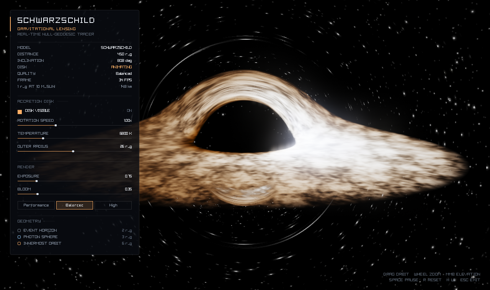
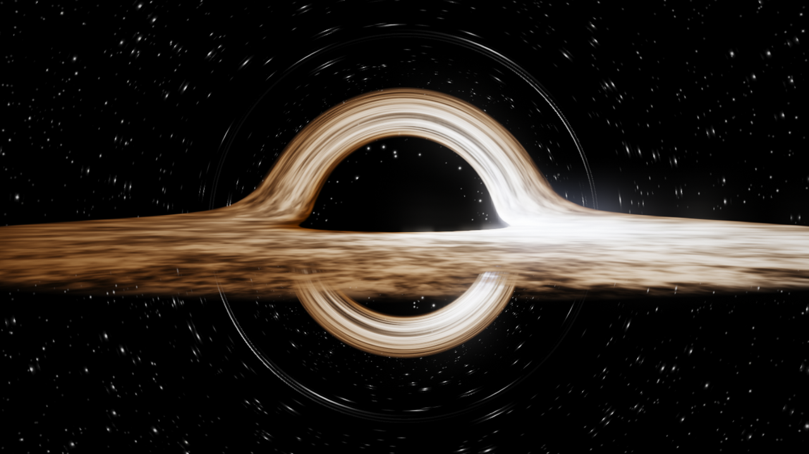

# Schwarzschild Black Hole — Real-Time Gravitational Lensing

An interactive, real-time black-hole renderer in C++20 + raylib. Every pixel is a
backward-traced null geodesic of the Schwarzschild metric, integrated on the GPU
with fourth-order Runge–Kutta in the orbital phase. The shadow, the photon ring,
the multiple images of the far side of the disk and the warped star field all
emerge from those trajectories — there is no UV warp, fisheye or lensing-strength
slider anywhere in the pipeline.





## Build

Requirements: CMake ≥ 3.24, a C++20 compiler, OpenGL 3.3. raylib **6.2** is
fetched automatically with `FetchContent` (or reused if a matching installed
copy is found), so the first configure needs network access; the application
itself never does.

Windows (MinGW-w64 UCRT64):

```bash
export PATH=/c/msys64/ucrt64/bin:$PATH
cmake -S . -B build -G Ninja -DCMAKE_BUILD_TYPE=Release
cmake --build build
./build/blackhole.exe
```

Linux / macOS (generic):

```bash
cmake -S . -B build -DCMAKE_BUILD_TYPE=Release
cmake --build build
./build/blackhole
```

Headless / reproducible captures (saves a PNG and exits):

```bash
./build/blackhole --capture shot.png --size 1600x900 --quality high \
                  --distance 34 --pitch 0.05 --yaw 2.2 --no-ui
```

Shaders are copied next to the executable after each build, and the loader also
falls back to the source tree, so the binary runs from the build directory, from
an install tree, or from any other working directory.

Tests (no GPU or window needed):

```bash
ctest --test-dir build --output-on-failure
```

## Physics

Distances are in gravitational radii, `r_g = GM/c²` (`G = c = 1`, `M = 1`):

| Feature | Radius |
|---|---|
| Event horizon | `2 r_g` |
| Photon sphere | `3 r_g` |
| ISCO (Schwarzschild) | `6 r_g` |
| Critical impact parameter | `3√3 r_g ≈ 5.196 r_g` |

**Ray tracing.** Each camera ray defines an orbital plane through the hole. With
`u = r_g/r` the photon obeys the Binet equation

```
d²u/dφ² + u = 3u²
```

which follows from `(dr/dλ)² = E² − L²(1 − 2u)/r²` and `dφ/dλ = L/r²`. Initial
conditions for a static observer at `r₀` whose ray makes angle `ψ` with the
outward radial direction:

```
b  = r₀ sin ψ / √(1 − 2/r₀)          (impact parameter |L|/E)
du/dφ = −cos ψ / b
```

The integrator is classical RK4 with a *uniform step in φ* (0.008–0.018 rad
depending on quality), capped at 200–460 steps. Termination:

* `u > 0.5` (inside `2 r_g`) → captured, the pixel stays on the shadow;
* `u ≤ 1/900` while `du/dφ < 0` → escaped to the background, sampled along
  `cos ψ = −b·du/dφ`, `sin ψ = b·u·√(1 − 2u)`;
* a step budget that runs out means a near-critical orbit winding at the photon
  sphere; it is treated as captured. This is what bounds the shader's runtime —
  there is no data-dependent unbounded loop.

3D positions come from rotating the radial basis about the orbital normal, so
plane-crossing tests and the rendered geometry share the same `(u, φ)` solution.

**Accretion disk.** A geometrically thin equatorial slab (`h/r ≈ 0.012`) between
`6 r_g` and a adjustable outer radius (26 r_g by default). Intersections are
found analytically as equatorial crossings between consecutive integration
points, so nothing depends on the volumetric step size. Optical depth is
`τ = ρ · 2h / |cos i|`, i.e. grazing rays accumulate a much longer column and the
disk becomes opaque edge-on, while face-on views stay translucent. Emission uses
a Shakura–Sunyaev effective temperature

```
T(r) ∝ [ (1 − √(r_in/r)) / r³ ]^¼
```

with `σT⁴` bolometric falloff, turbulent density and temperature modulation from
a seamless procedural noise field advected by the local Keplerian rate
`Ω = r^(-3/2)`, so the pattern shears into trailing filaments on its own.

**Relativistic shifts.** Each disk sample is shifted by

```
g = ν_obs/ν_emit = √(1 − 3M/r) / (1 − Ω · L_φ/E)
```

where `L_φ/E` is the traced photon's conserved angular momentum about the disk
axis (its sign follows the ray). `g` drives both the blackbody colour
(`T_obs = g·T(r)`) and the beaming `I ∝ g⁴`, so the approaching side is
brighter, bluer and the receding side dimmer and redder. The transverse Doppler
and gravitational terms are in the numerator; the longitudinal term in the
denominator.

**Sky.** A 4096 × 2048 procedural star field (22 000 deterministic stars with a
magnitude distribution, blackbody colours and a few bright ones), sampled at
LOD 0 through the computed escape direction. Because the sample is taken along
the *deflected* direction, stars are displaced, magnified into arcs and
multiply imaged near the shadow for free.

## Rendering

```
scene (HDR RGBA16F, scaled internal resolution)
  → bright-pass + two-scale Gaussian bloom (1/4 and 1/8 res, separable)
  → ACES tone map, exposure, bloom mix, vignette, gamma, 1/255 dither
  → upscaled to the window
```

All per-pixel physics is in `shaders/blackhole.fs`; the C++ side only manages
windows, input, uniforms and passes.

| Preset | Internal resolution | φ step | Max steps | Rays/pixel |
|---|---|---|---|---|
| Performance | 62 % | 0.018 rad | 200 | 1 |
| Balanced | 82 % | 0.012 rad | 320 | 1 |
| High | 88 % | 0.008 rad | 460 | 2 (jittered) |

## Controls

| Input | Action |
|---|---|
| Left drag | Orbit the camera |
| Mouse wheel | Zoom |
| Middle drag (or Ctrl + right drag) | Change elevation |
| Arrow keys, `+` / `-` | Orbit / zoom from the keyboard |
| `Space` | Pause or resume disk animation |
| `R` | Reset the camera and view |
| `H` | Show or hide the interface |
| `1` / `2` / `3` | Performance / Balanced / High quality |
| `Esc` | Quit |

The camera is clamped to `[8, 90] r_g` and to `±83°` elevation, so it can never
enter the horizon or the photon sphere (8 r_g is outside the ISCO), and the
orbit basis stays well conditioned away from the poles.

The panel shows the model, camera distance in `r_g`, inclination, animation
state, quality, frame rate and the physical scale of one `r_g` at 10 M☉, plus a
legend for the horizon, photon sphere and ISCO. Its controls (disk visibility,
rotation speed, disk temperature, outer radius, exposure, bloom, quality,
interface) all write the live simulation state used by the renderer — nothing is
decorative.

## Layout

```
CMakeLists.txt
include/  geodesic.hpp            CPU reference integrator + disk kinematics
          simulation_parameters.hpp  parameters, quality presets, scale helpers
          textures.hpp            procedural sky + noise generation
          camera_controller.hpp   orbit camera with damping and clamps
          renderer.hpp            HDR targets, bloom, composite passes
          ui.hpp                  immediate-mode panel
          application.hpp         window, loop, input
src/      main.cpp                CLI parsing
          application.cpp camera_controller.cpp renderer.cpp
          simulation_parameters.cpp textures.cpp ui.cpp
shaders/  blackhole.fs            geodesic tracing, disk shading, sky
          blur.fs                 separable Gaussian
          composite.fs            bloom mix, ACES, gamma
tests/    physics_tests.cpp       49 assertions, no GPU required
```

## Approximations and known limits

* **Schwarzschild only** — no spin, so no frame dragging, no ergosphere and a
  circular shadow. The ISCO is fixed at `6 r_g`; inner-disk radius != ISCO is not
  offered, by design.
* **Thin, opaque-when-grazing disk.** The vertical structure is a slab of
  constant `h/r` with no radiative transfer: no scattering, no self-illumination,
  no limb darkening. Multiple crossings are composited front to back, which is
  what produces the lensed second and third images of the far side.
* **Uniform φ step.** Adaptive stepping would be faster near the photon sphere;
  the uniform step plus a step cap keeps the shader branch-light and bounded.
  Rays that exhaust the budget are near-critical and are drawn as shadow — a
  measure-zero set, but it slightly thickens the shadow's edge at Low quality.
* **No disk self-gravity, no magnetohydrodynamics.** Turbulence is procedural
  noise advected at the Keplerian rate, not a simulation.
* **Star field is synthetic.** Positions and colours are deterministic
  procedural values, not a real catalogue.
* Bloom, vignette, contrast and the blackbody fit are deliberate artistic
  choices layered on top of the physically computed radiance.

## Verification

Performed on Windows 11, GCC 16.2 (MinGW-w64 UCRT64), CMake 4.4, NVIDIA GPU:

* Clean Release configure + build with `-Wall -Wextra -Wpedantic`: no warnings
  from project code.
* `ctest`: 1/1 test binary passes, 49 assertions — deflection angles against the
  known weak-field limit, capture threshold at `b = 3√3 r_g`, photon-sphere
  winding, first-integral conservation, disk-crossing radii, frequency-shift
  symmetry, parameter clamping, quality-preset validity.
* Shader compiles as GLSL 330 with no diagnostics; every uniform the shader
  declares is located and uploaded (the renderer aborts and reports if one is
  ever missing).
* Rendered frames captured at several inclinations and distances (see
  `docs/`), plus a run from an unrelated working directory to confirm asset
  resolution.
* Measured throughput at 1280×760: 180 frames in ~3.7 s wall time including sky
  generation, i.e. all three presets reach the 60 Hz vsync cap on this machine;
  the presets differ in internal resolution and integration cost, so slower GPUs
  will separate.

Not verified automatically: interactive mouse dragging and window resizing were
checked by launching the window (screenshot of the panel) rather than by scripted
input, and HiDPI scaling was not exercised.
